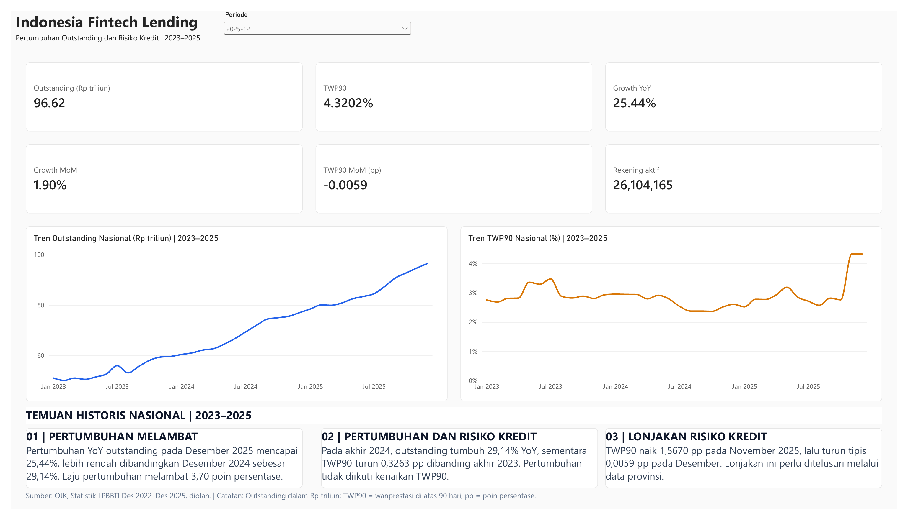
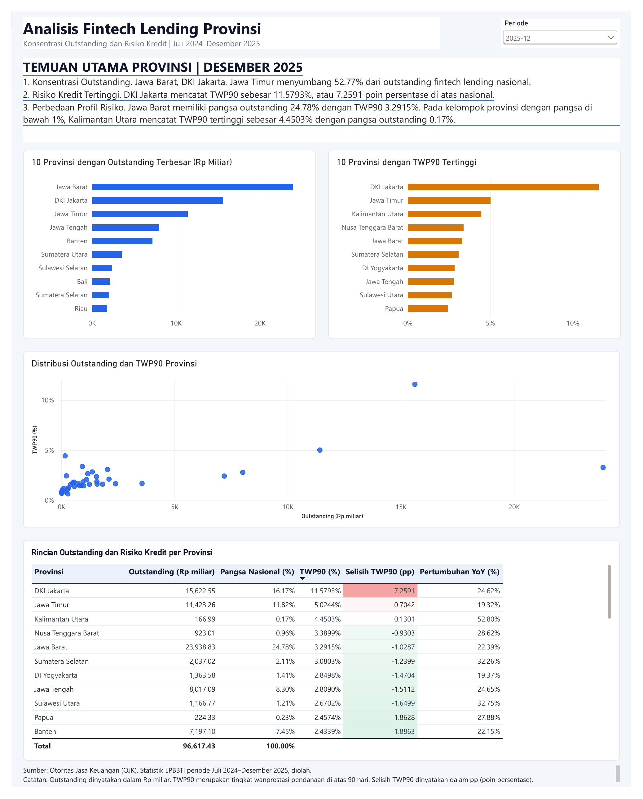

# Analisis Fintech Lending Indonesia 2023–2025

### Analisis Data OJK Menggunakan Excel Power Query, MySQL, dan Power BI

Proyek ini bertujuan menganalisis perkembangan industri fintech lending Indonesia berdasarkan Statistik Layanan Pendanaan Bersama Berbasis Teknologi Informasi (LPBBTI) yang dipublikasikan oleh Otoritas Jasa Keuangan (OJK).

Analisis berfokus pada perkembangan outstanding pinjaman, jumlah rekening penerima pinjaman aktif, tingkat wanprestasi pinjaman lebih dari 90 hari (TWP90), serta perbedaan kondisi fintech lending antarprovinsi.

Proyek ini mengintegrasikan proses pengolahan data menggunakan Excel Power Query, validasi dan analisis menggunakan MySQL, serta visualisasi interaktif menggunakan Power BI.

Repositori ini menyediakan dokumentasi teknis, skrip SQL, gambar dashboard, dan laporan visualisasi sebagai bagian dari portofolio analisis data.

---

## 1. Latar Belakang

Fintech lending merupakan salah satu bentuk layanan keuangan digital yang menyediakan alternatif akses pendanaan bagi masyarakat Indonesia.

Perkembangan industri ini tidak hanya dapat diamati melalui pertumbuhan pinjaman, tetapi juga perlu memperhatikan kualitas pembiayaan yang tercermin dalam indikator risiko kredit.

Outstanding menunjukkan nilai pinjaman yang masih belum dilunasi, sedangkan TWP90 menggambarkan tingkat wanprestasi pinjaman lebih dari 90 hari.

Di sisi lain, distribusi outstanding dan tingkat TWP90 antarprovinsi dapat menunjukkan adanya perbedaan konsentrasi aktivitas fintech lending dan kondisi risiko kredit pada masing-masing wilayah.

Oleh karena itu, proyek ini dikembangkan untuk menyajikan analisis perkembangan fintech lending secara nasional dan provinsi melalui pengolahan data yang terstruktur serta dashboard interaktif.

---

## 2. Tujuan Analisis

Proyek ini dirancang untuk menjawab beberapa pertanyaan utama:

1. Bagaimana perkembangan outstanding fintech lending Indonesia selama periode 2023–2025?
2. Bagaimana pertumbuhan outstanding secara bulanan dan tahunan?
3. Bagaimana perkembangan jumlah rekening penerima pinjaman aktif?
4. Bagaimana perubahan TWP90 nasional dari waktu ke waktu?
5. Provinsi mana yang memiliki outstanding pinjaman terbesar?
6. Bagaimana perbedaan tingkat TWP90 antarprovinsi?
7. Seberapa besar konsentrasi outstanding pada provinsi-provinsi dengan nilai pinjaman terbesar?

---

## 3. Teknologi yang Digunakan

| Teknologi | Penggunaan |
|---|---|
| Microsoft Excel | Pengolahan dan pemeriksaan data sumber |
| Power Query | ETL, transformasi, standardisasi, penggabungan, dan validasi data |
| MySQL | Penyimpanan, validasi, dan analisis data menggunakan SQL |
| MySQL Workbench | Pengelolaan database dan eksekusi query |
| Power BI | Pemodelan data, perhitungan DAX, dan visualisasi interaktif |

### Alur Pengolahan Data

```text
Publikasi Statistik LPBBTI OJK
              |
              v
     Excel Power Query
              |
              v
    Transformasi dan Validasi
              |
              v
      Dataset CSV Final
              |
              v
        MySQL Database
              |
              v
     Analisis dan SQL Views
              |
              v
      Dashboard Power BI
              |
              v
       Laporan dan Insight
```

Alur tersebut menggambarkan proses analisis yang telah dilakukan pada lingkungan kerja lokal.

---

## 4. Sumber dan Cakupan Data

**Sumber utama:** Otoritas Jasa Keuangan (OJK)

**Publikasi:** Statistik Layanan Pendanaan Bersama Berbasis Teknologi Informasi (LPBBTI)

Sumber data dapat diakses melalui:

- [Statistik Fintech OJK](https://ojk.go.id/id/kanal/iknb/data-dan-statistik/fintech/default.aspx)
- [Statistik LPBBTI Desember 2025](https://ojk.go.id/id/kanal/iknb/data-dan-statistik/fintech/Pages/Statistik-LPBBTI-Desember-2025.aspx)
- [Portal Data OJK](https://data.ojk.go.id/SJKPublic)

### Cakupan Dataset

| Dataset | Cakupan Periode | Jumlah Observasi |
|---|---|---:|
| Nasional | Desember 2022 sampai Desember 2025 | 37 |
| Provinsi | Juli 2024 sampai Desember 2025 | 684 |

Periode Desember 2022 digunakan sebagai data awal pembanding dalam analisis nasional.

Dataset provinsi terdiri atas 38 provinsi dengan 18 observasi bulanan pada setiap provinsi.

### Indikator Utama

**1. Outstanding Pinjaman**

Menunjukkan nilai pinjaman yang masih belum dilunasi pada periode pelaporan.

Outstanding dalam dataset dinyatakan dalam miliar rupiah.

**2. Rekening Penerima Pinjaman Aktif**

Menunjukkan jumlah rekening penerima pinjaman aktif sesuai statistik OJK.

Indikator ini tidak otomatis merepresentasikan jumlah individu unik karena satu orang dapat memiliki lebih dari satu rekening.

**3. Tingkat Wanprestasi 90 Hari (TWP90)**

Menggambarkan tingkat wanprestasi pinjaman lebih dari 90 hari.

Dalam dataset hasil pengolahan, TWP90 disimpan sebagai proporsi dan ditampilkan sebagai persentase dalam analisis.

---

## 5. Tahapan Pengerjaan Proyek

### Tahap 1. Pengumpulan Data

Data diperoleh dari publikasi Statistik LPBBTI OJK.

File Excel sumber digunakan untuk memperoleh indikator outstanding, jumlah rekening aktif, dan TWP90 pada tingkat nasional maupun provinsi.

Publikasi dari beberapa periode digunakan untuk membangun rangkaian data yang sesuai dengan kebutuhan analisis.

### Tahap 2. ETL Menggunakan Excel Power Query

Proses Extract, Transform, Load (ETL) dilakukan untuk menghasilkan data yang terstruktur dan konsisten.

Tahapan utamanya meliputi:

1. Mengimpor data dari file Excel OJK.
2. Mengidentifikasi dan menyesuaikan struktur tabel.
3. Mengubah format data menggunakan unpivot.
4. Memisahkan informasi wilayah, periode, indikator, dan nilai.
5. Menstandardisasi nama indikator dan provinsi.
6. Menggabungkan data dari beberapa periode publikasi.
7. Memeriksa cakupan data, duplikasi, dan konsistensi nilai.
8. Menyiapkan dataset nasional dan provinsi untuk analisis lanjutan.

Workbook pengolahan menggunakan 52 Power Query yang mencakup proses transformasi, integrasi, validasi, dan ekspor data.

Hasil akhir ETL terdiri atas dua dataset:

- `fintech_lending_national.csv`
- `fintech_lending_province.csv`

Kedua dataset disimpan dalam lingkungan kerja lokal dan tidak disertakan dalam repositori publik ini.

Proses pengolahan dijelaskan dalam [Dokumentasi ETL](docs/etl_process.md).

### Tahap 3. Pengolahan dan Analisis Menggunakan MySQL

Data hasil ETL digunakan dalam database MySQL bernama `fintech_lending`.

Proses analisis SQL meliputi:

1. Pembuatan database.
2. Pembuatan staging tables.
3. Impor data CSV.
4. Validasi hasil impor.
5. Pembuatan tabel analisis.
6. Konversi tipe data.
7. Validasi hasil transformasi.
8. Analisis pertumbuhan outstanding nasional.
9. Analisis risiko kredit melalui TWP90.
10. Analisis portofolio dan risiko antarprovinsi.
11. Pembuatan reporting views.

Seluruh proses SQL didokumentasikan dalam 10 skrip pada folder `sql/`.

### Tahap 4. Visualisasi Menggunakan Power BI

Data hasil analisis digunakan untuk membuat dashboard interaktif.

Visualisasi dirancang untuk membantu pengguna memahami perkembangan fintech lending dari waktu ke waktu serta membandingkan indikator antarprovinsi.

Dashboard terdiri atas dua halaman utama:

- Overview Nasional
- Analisis Provinsi

Gambar dashboard dan laporan PDF tersedia dalam repositori ini.

---

## 6. Hasil Analisis Nasional

Berdasarkan data Desember 2025, diperoleh hasil berikut:

| Indikator | Nilai |
|---|---:|
| Outstanding Pinjaman | Rp96.617,431 miliar |
| Pertumbuhan Outstanding MoM | 1,90% |
| Pertumbuhan Outstanding YoY | 25,44% |
| TWP90 | 4,3202% |
| Rekening Penerima Pinjaman Aktif | 26.104.165 |

### Temuan Utama

**1. Outstanding pinjaman menunjukkan pertumbuhan.**

Pada Desember 2025, outstanding fintech lending mencapai Rp96.617,431 miliar.

Nilai tersebut meningkat 1,90% dibandingkan November 2025 dan 25,44% dibandingkan Desember 2024.

Hasil ini menunjukkan adanya peningkatan nilai pinjaman yang masih berjalan pada akhir periode pengamatan.

**2. Risiko kredit tetap perlu diperhatikan.**

TWP90 pada Desember 2025 tercatat sebesar 4,3202%.

Indikator ini penting untuk melengkapi analisis pertumbuhan outstanding karena peningkatan nilai pinjaman tidak secara otomatis menunjukkan perbaikan kualitas pembiayaan.

Oleh karena itu, perkembangan outstanding perlu diamati bersama indikator risiko kredit.

**3. Analisis wilayah memberikan informasi tambahan.**

Perbandingan antarprovinsi memungkinkan identifikasi wilayah dengan outstanding terbesar, perbedaan TWP90, serta konsentrasi outstanding pada sejumlah provinsi.

Analisis wilayah membantu memberikan gambaran yang lebih terperinci dibandingkan hanya menggunakan indikator nasional.

Temuan ini bersifat deskriptif dan tidak digunakan untuk menyimpulkan hubungan sebab-akibat antara pertumbuhan pinjaman dan risiko kredit.

---

## 7. Dashboard Power BI

Dashboard dikembangkan menggunakan Power BI Desktop untuk menyajikan informasi secara visual.

### 7.1 Overview Nasional

Halaman Overview Nasional menampilkan perkembangan fintech lending pada tingkat Indonesia secara keseluruhan.

Komponen utamanya meliputi:

- KPI outstanding pinjaman.
- Pertumbuhan outstanding bulanan.
- Pertumbuhan outstanding tahunan.
- Jumlah rekening penerima pinjaman aktif.
- TWP90.
- Perubahan TWP90.
- Grafik perkembangan indikator.
- Temuan utama periode pengamatan.



### 7.2 Analisis Provinsi

Halaman Analisis Provinsi menampilkan perbandingan indikator fintech lending antarwilayah.

Fitur analisis meliputi:

- Perbandingan outstanding antarprovinsi.
- Analisis TWP90 provinsi.
- Konsentrasi outstanding.
- Perbandingan indikator berdasarkan periode.
- Visualisasi hubungan indikator.
- Temuan yang mengikuti konteks pemilihan data.



### 7.3 Laporan Dashboard

Tampilan dashboard dalam format PDF dapat diakses melalui:

**[Lihat Laporan Dashboard Power BI (PDF)](reports/Fintech_Lending_Dashboard.pdf)**

Versi PDF digunakan untuk melihat hasil visualisasi tanpa membuka Power BI Desktop.

Dashboard asli dibuat secara interaktif menggunakan Power BI Desktop. Namun, file PBIX tidak disertakan dalam repositori publik ini.

Interaktivitas seperti penggunaan filter dan pemilihan periode tidak tersedia dalam gambar maupun PDF.

---

## 8. Struktur Repositori

```text
indonesia-fintech-lending-analysis/
│
├── docs/
│   ├── data_dictionary.md
│   ├── data_validation.md
│   ├── etl_process.md
│   └── sql_analysis.md
│
├── sql/
│   ├── 01_setup_database.sql
│   ├── 02_create_staging_tables.sql
│   ├── 03_check_staging_import.sql
│   ├── 04_create_analysis_tables.sql
│   ├── 05_load_analysis_tables.sql
│   ├── 06_validate_analysis_tables.sql
│   ├── 07_national_growth_analysis.sql
│   ├── 08_national_credit_risk_analysis.sql
│   ├── 09_province_portfolio_risk_analysis.sql
│   └── 10_create_reporting_views.sql
│
├── images/
│   ├── overview_nasional.png
│   └── analisis_provinsi.png
│
├── reports/
│   └── Fintech_Lending_Dashboard.pdf
│
└── README.md
```

**Catatan:** Struktur di atas menggambarkan isi repositori publik.

File sumber OJK, dataset hasil pengolahan, workbook Excel Power Query, dan file Power BI Desktop disimpan secara terpisah.

File tersebut tidak disertakan dalam repositori ini sebagai langkah kehati-hatian terkait ketentuan penggunaan ulang data dan informasi koneksi lokal.

---

## 9. Dokumentasi Teknis

Penjelasan mengenai proses pengolahan dan analisis tersedia dalam dokumen berikut:

| Dokumentasi | Deskripsi |
|---|---|
| [Kamus Data](docs/data_dictionary.md) | Definisi kolom, indikator, satuan, dan format dataset |
| [Proses ETL](docs/etl_process.md) | Pengolahan data menggunakan Excel Power Query |
| [Analisis SQL](docs/sql_analysis.md) | Tahapan pengelolaan, validasi, dan analisis menggunakan MySQL |
| [Validasi Data](docs/data_validation.md) | Pemeriksaan struktur, konsistensi, dan kualitas data |

Dokumentasi disusun untuk menjelaskan tahapan pengerjaan proyek dan mempermudah evaluasi terhadap metode analisis yang digunakan.

---

## 10. Cara Menggunakan Repositori

### 10.1 Melihat Hasil Dashboard

Hasil visualisasi dapat dilihat melalui:

- Gambar dashboard pada folder `images/`.
- Laporan PDF pada folder `reports/`.

File tersebut memungkinkan pengguna melihat hasil analisis tanpa perlu menjalankan MySQL maupun Power BI Desktop.

### 10.2 Menggunakan Dataset

Analisis menggunakan dua dataset hasil pengolahan:

1. `fintech_lending_national.csv`
2. `fintech_lending_province.csv`

Kedua dataset merupakan hasil transformasi data statistik LPBBTI yang dipublikasikan OJK.

Dataset tidak disertakan dalam repositori publik ini.

Definisi kolom, format data, cakupan periode, dan proses transformasi dijelaskan dalam dokumentasi berikut:

- [Kamus Data](docs/data_dictionary.md)
- [Proses ETL](docs/etl_process.md)

Sumber publikasi statistik dapat diakses melalui situs resmi OJK yang dicantumkan pada bagian Sumber dan Atribusi.

### 10.3 Menjalankan Analisis SQL

Repositori menyediakan 10 skrip SQL yang mendokumentasikan proses pembuatan database, validasi, transformasi, dan analisis data.

Untuk menjalankan seluruh proses:

1. Instal MySQL dan MySQL Workbench.
2. Siapkan dataset CSV nasional dan provinsi dengan struktur sesuai dokumentasi kamus data.
3. Jalankan `01_setup_database.sql`.
4. Jalankan `02_create_staging_tables.sql`.
5. Impor dataset CSV ke staging tables menggunakan Table Data Import Wizard.
6. Jalankan skrip `03` sampai `10` sesuai urutan.

**Perhatian:** Dataset CSV tidak disertakan dalam repositori ini. Karena itu, proses SQL tidak dapat dijalankan secara lengkap tanpa menyediakan data yang sesuai.

Tahap impor CSV masih dilakukan secara manual.

Sebagian skrip SQL belum dirancang untuk dijalankan berulang kali pada database yang sudah berisi data.

Penjelasan lengkap tersedia pada [Dokumentasi Analisis SQL](docs/sql_analysis.md).

---

## 11. Validasi Data

Validasi dilakukan untuk memastikan kelengkapan dan konsistensi dataset yang digunakan dalam proyek.

Pemeriksaan mencakup:

- Jumlah observasi.
- Kelengkapan periode.
- Duplikasi data.
- Nilai kosong.
- Rentang nilai TWP90.
- Outstanding negatif.
- Kesesuaian hasil transformasi.
- Rekonsiliasi outstanding nasional dan provinsi.

Hasil pemeriksaan terhadap dua CSV final menunjukkan:

| Pemeriksaan | Hasil |
|---|---|
| Observasi nasional | 37 |
| Observasi provinsi | 684 |
| Jumlah provinsi | 38 |
| Duplikasi nasional | 0 |
| Duplikasi provinsi | 0 |
| Nilai kosong | Tidak ditemukan |
| Outstanding negatif | Tidak ditemukan |
| TWP90 di luar rentang 0–1 | Tidak ditemukan |
| Rekonsiliasi outstanding provinsi dengan nasional | Sesuai pada 18 periode |

Rekonsiliasi dilakukan dengan menjumlahkan outstanding seluruh provinsi dan membandingkannya dengan outstanding nasional pada periode yang sama.

Pemeriksaan terhadap sumber asli OJK juga dilakukan menggunakan sampel data tertentu.

Hasil validasi tersebut tidak berarti seluruh sel pada setiap publikasi OJK telah diperiksa secara manual.

Penjelasan lengkap tersedia pada [Dokumentasi Validasi Data](docs/data_validation.md).

---

## 12. Keterbatasan Proyek

Beberapa keterbatasan yang perlu diperhatikan:

1. Data provinsi hanya mencakup Juli 2024 sampai Desember 2025, sehingga lebih pendek daripada cakupan data nasional.
2. Workbook Power Query menggunakan koneksi file lokal yang perlu diperbarui apabila proyek dipindahkan ke komputer lain.
3. Dataset CSV tidak tersedia dalam repositori publik sehingga analisis SQL tidak langsung dapat dijalankan dari awal.
4. Impor CSV ke MySQL masih dilakukan secara manual menggunakan Table Data Import Wizard.
5. Sebagian skrip SQL belum dirancang untuk dijalankan berulang kali tanpa penyesuaian.
6. Pemeriksaan terhadap publikasi OJK dilakukan pada sampel dan titik pemeriksaan tertentu.
7. Analisis bersifat deskriptif dan tidak digunakan untuk membuktikan hubungan sebab-akibat.
8. File PBIX tidak tersedia dalam repositori sehingga dashboard interaktif tidak dapat dijalankan langsung dari file proyek ini.

Keterbatasan tersebut dicantumkan untuk menjelaskan cakupan pekerjaan dan membantu pembaca menafsirkan hasil analisis secara tepat.

---

## 13. Kesimpulan

Proyek ini menunjukkan penerapan proses analisis data secara bertahap, mulai dari pengumpulan data, transformasi dan validasi, analisis SQL, hingga pembuatan dashboard interaktif.

Hasil analisis memberikan gambaran mengenai perkembangan outstanding fintech lending Indonesia, pertumbuhan pinjaman, jumlah rekening penerima pinjaman aktif, tingkat TWP90, dan perbedaan indikator antarprovinsi.

Penggunaan Excel Power Query membantu menyiapkan dataset yang terstruktur, MySQL digunakan untuk analisis serta pemeriksaan konsistensi data, dan Power BI digunakan untuk menyajikan hasil secara visual.

Proyek ini juga mendokumentasikan tahapan pengolahan serta pemeriksaan data agar proses analisis dapat dipahami dan dievaluasi.

---

## 14. Sumber dan Atribusi

Data statistik yang digunakan dalam proyek ini bersumber dari Otoritas Jasa Keuangan (OJK).

### Sumber Utama

- [Statistik Fintech OJK](https://ojk.go.id/id/kanal/iknb/data-dan-statistik/fintech/default.aspx)
- [Statistik LPBBTI Desember 2025](https://ojk.go.id/id/kanal/iknb/data-dan-statistik/fintech/Pages/Statistik-LPBBTI-Desember-2025.aspx)

### Sumber Alternatif

- [Portal Data OJK](https://data.ojk.go.id/SJKPublic)

Proyek ini dibuat untuk tujuan pembelajaran dan pengembangan portofolio analisis data.

Hak atas publikasi statistik sumber tetap berada pada pihak yang berwenang. Penggunaan ulang data harus memperhatikan ketentuan yang berlaku dari OJK.

---

## 15. Informasi Proyek

| Informasi | Keterangan |
|---|---|
| Nama Proyek | Indonesia Fintech Lending Analysis |
| Bidang | Data Analytics dan Business Intelligence |
| Industri | Financial Technology |
| Sumber Data | Otoritas Jasa Keuangan (OJK) |
| Cakupan Analisis | Indonesia |
| Periode Analisis | 2023–2025 |
| Teknologi | Excel, Power Query, MySQL, Power BI |
| Jenis Analisis | Deskriptif, Pertumbuhan, Risiko Kredit, dan Analisis Wilayah |
| Tujuan | Pembelajaran dan Portofolio Data Analyst |

---

**Indonesia Fintech Lending Analysis | Data Analytics Portfolio**